# Bandwidths

> This article retains its original experiments and examples. For
> current package usage, see the [usage
> guide](https://jlmelville.github.io/smallvis/package/articles/usage.md).

The investigation of the [three
clusters](https://jlmelville.github.io/smallvis/package/articles/three-clusters.md)
dataset found that using ASNE with the input bandwidths used in the
output kernel solved all the problems with strange distortions occuring
at higher perplexities. Unfortunately, there was reason to believe that
this would not generalize to other datasets. Let’s see if that is the
case.

Also, the original description of
[NeRV](http://www.jmlr.org/papers/v11/venna10a.md) transferred
bandwidths directly from the input kernel to the output kernel. So there
is a literature precedent for this. However, later publications about
NeRV don’t mention this step, so it may have turned out to be a bad
idea. We shall see.

## Datasets

See the
[Datasets](https://jlmelville.github.io/smallvis/package/articles/datasets.md)
page.

## Evaluation

Apart from visualizing the results, the mean neighbor preservation of
the 40 closest neighbors is used to provide a rough quantification of
the quality of the result, labelled as `mnp@40` in the plots.

## Settings

Adding bandwidths massively changes the magnitude of the gradients
compared to non-bandwidth methods. This required extensive learning rate
twiddling, both on a per-method *and* per-dataset basis.

``` r

# eta = 1000 for basne
# eta = 20000 for btasne
mnist_bnerv <- smallvis(
  s1k,
  scale = FALSE,
  perplexity = 40,
  Y_init = "spca",
  method = "bnerv",
  eta = 100,
  max_iter = 2000,
  epoch = 100
)
```

## Results

Given the lack of anything interesting happening with SSNE, t-SNE and
their bandwidthed equivalents on the [Swiss
Roll](https://jlmelville.github.io/smallvis/package/articles/swisssne.md)
data, to save some effort, we’ll only look at ASNE and t-ASNE, and their
bandwidthed versions below.

### iris

|  |  |
|:--:|:--:|
| 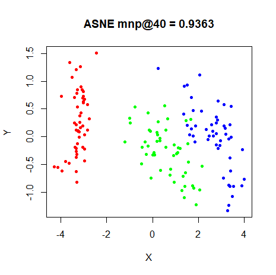 | 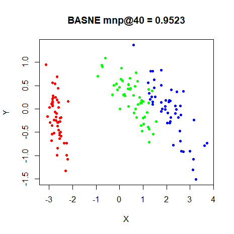 |
| 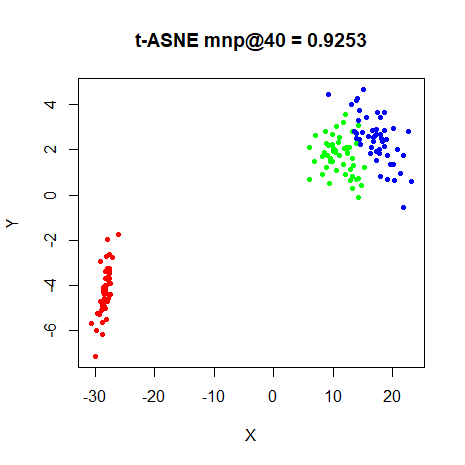 | 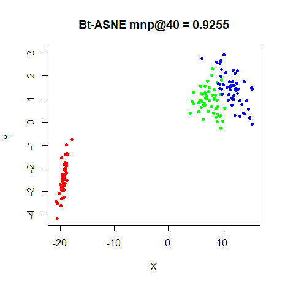 |
| 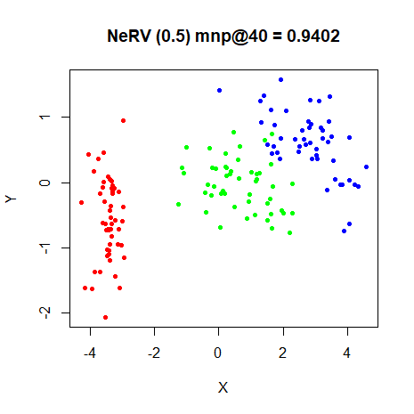 | 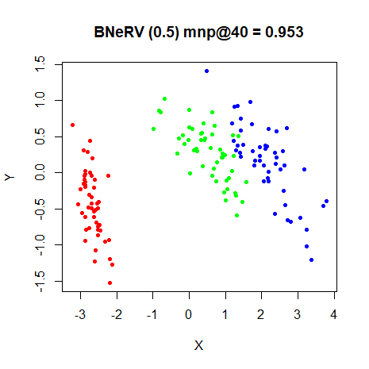 |

### s1k

|  |  |
|:--:|:--:|
| 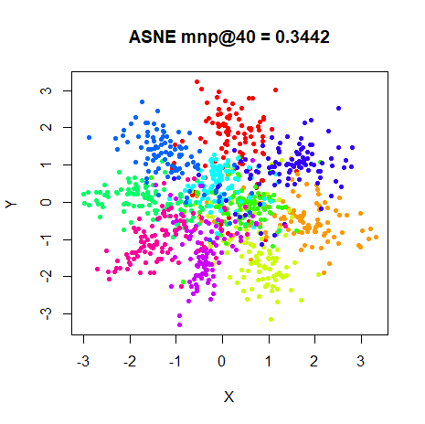 | 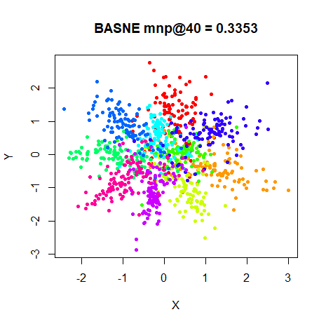 |
| 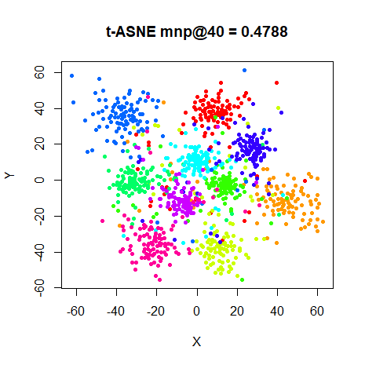 | 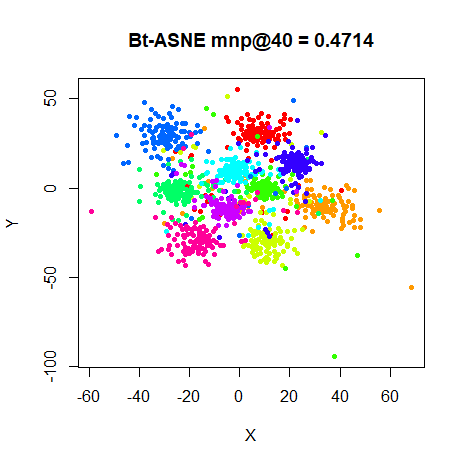 |
| 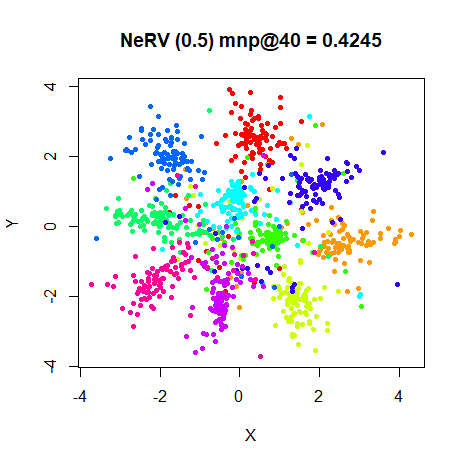 | 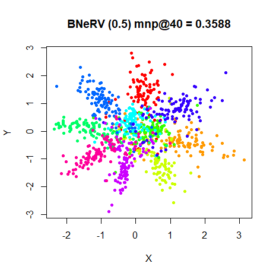 |

### oli

|  |  |
|:--:|:--:|
| 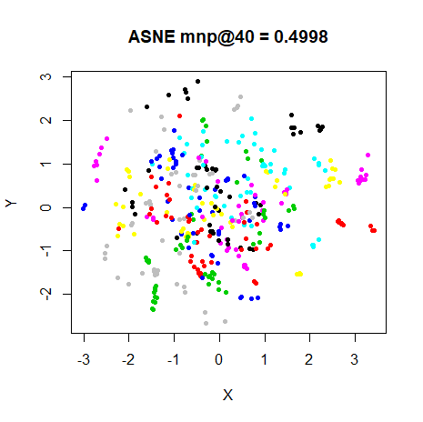 | 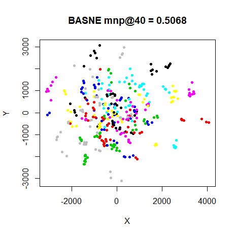 |
| 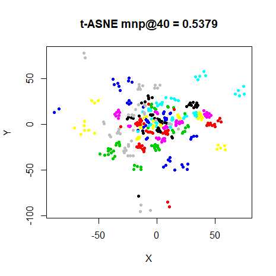 | 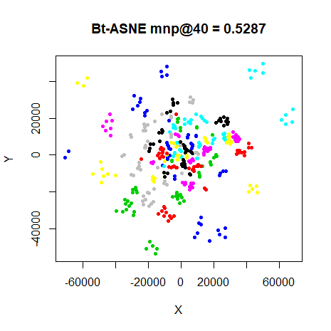 |
| 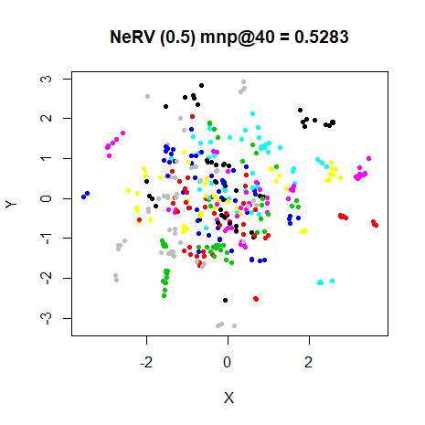 | 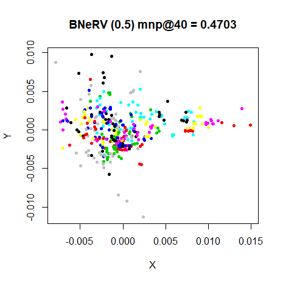 |

### frey

|  |  |
|:--:|:--:|
| 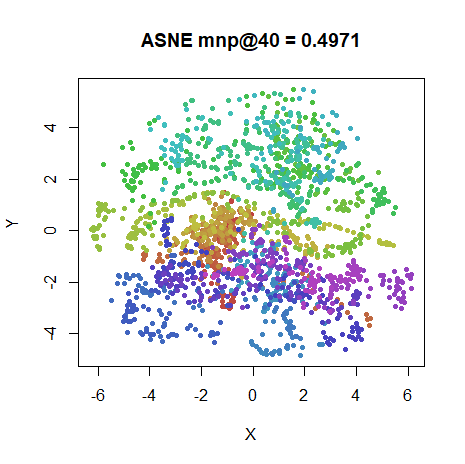 | 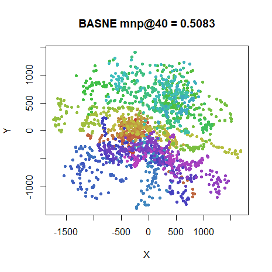 |
| 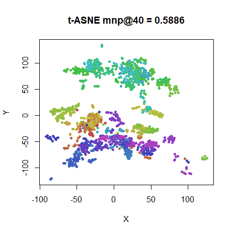 | 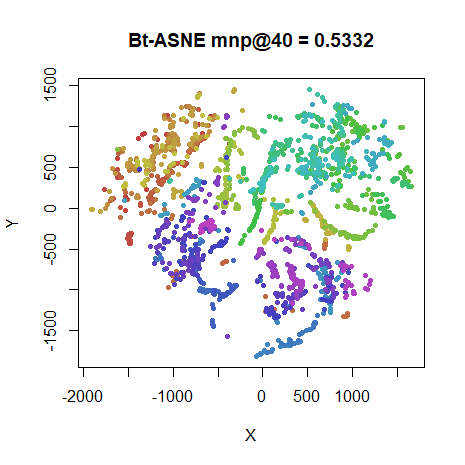 |
| 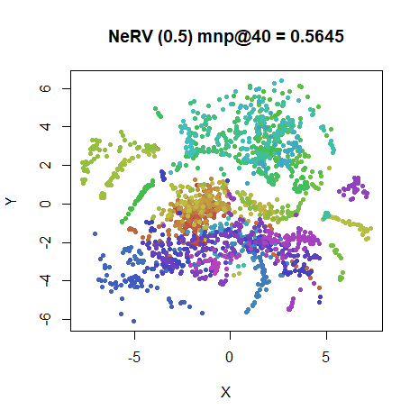 | 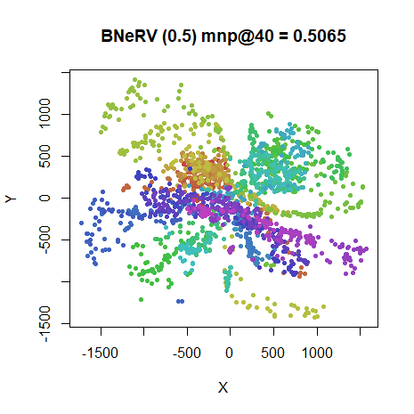 |

### coil20

|  |  |
|:--:|:--:|
| 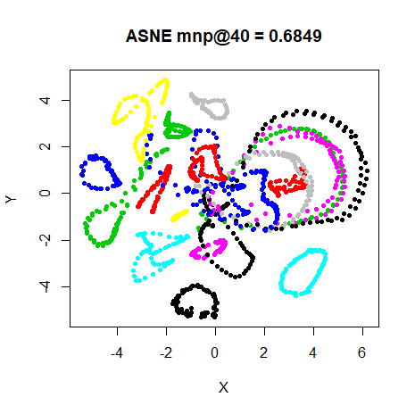 | 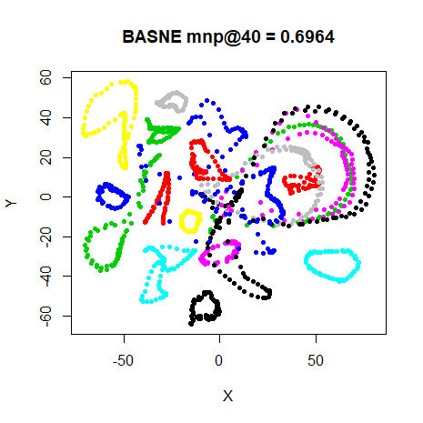 |
| 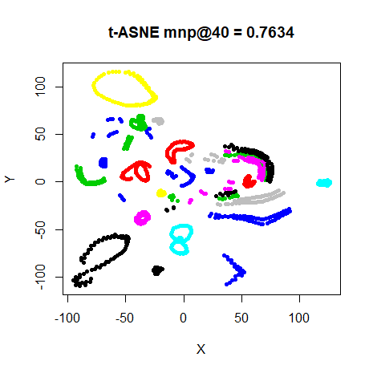 | 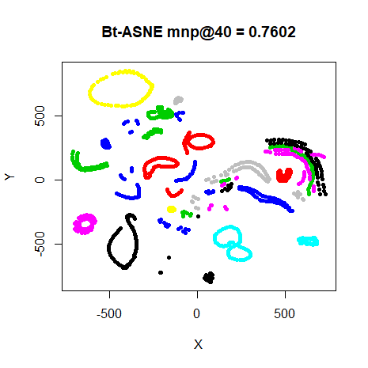 |
| 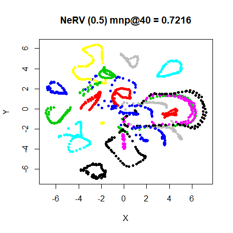 | 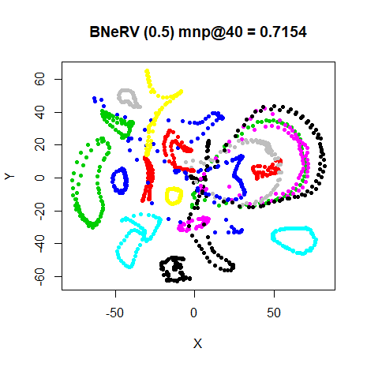 |

### mnist

|  |  |
|:--:|:--:|
| 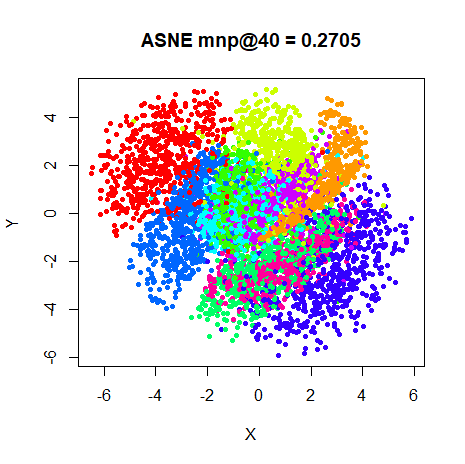 | 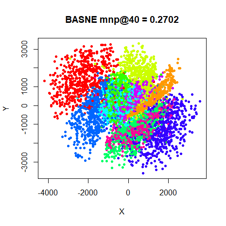 |
| 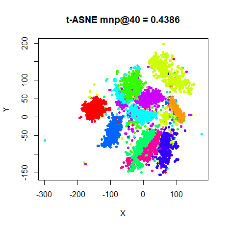 | 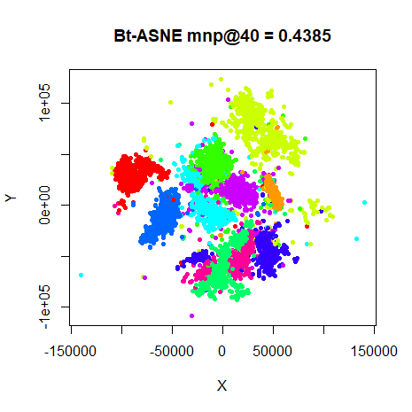 |
| 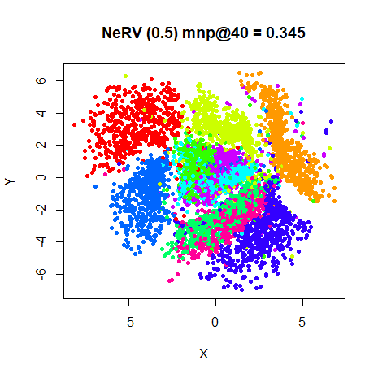 | 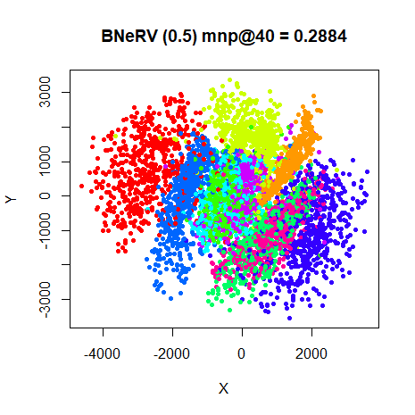 |

### fashion

|  |  |
|:--:|:--:|
| 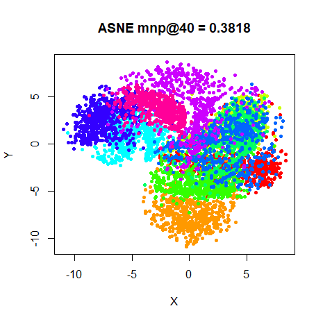 | 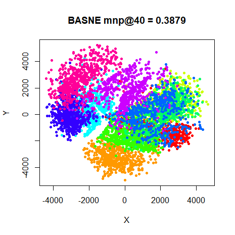 |
| 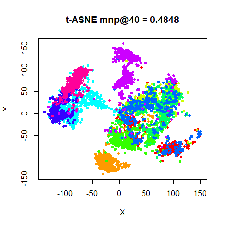 | 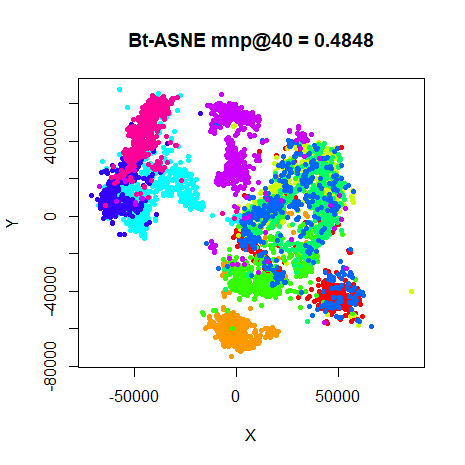 |
| 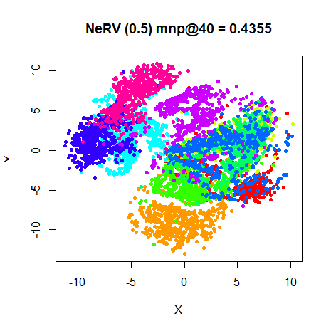 | 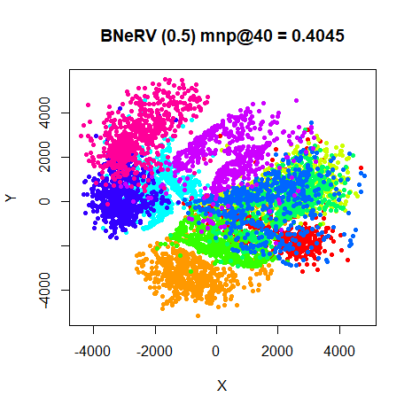 |

## Conclusions

In terms of neighborhood preservation, there are a few datasets (`iris`,
`oli`, `frey` and `coil20`) where adding bandwidths to ASNE improves the
results by a tiny amount. But it’s not a major improvement: t-ASNE
always outperforms BASNE except on the consistently anomalous `iris`
dataset. So it’s not hugely to discover that t-ASNE and NeRV are
improved by adding bandwidths to the output kernel only for `iris`.

Adding bandwidths directly from the input kernel to the output kernel
has nothing to recommend it, so it’s not surprising that the NeRV method
stopped doing it.
